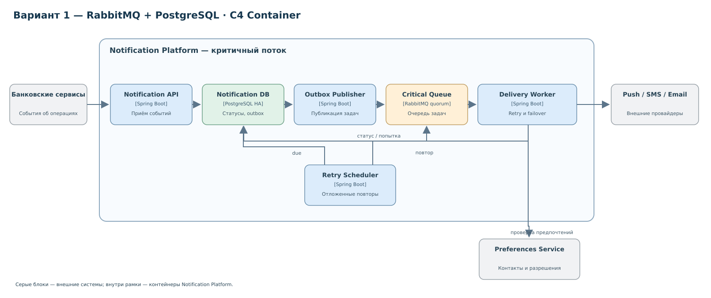
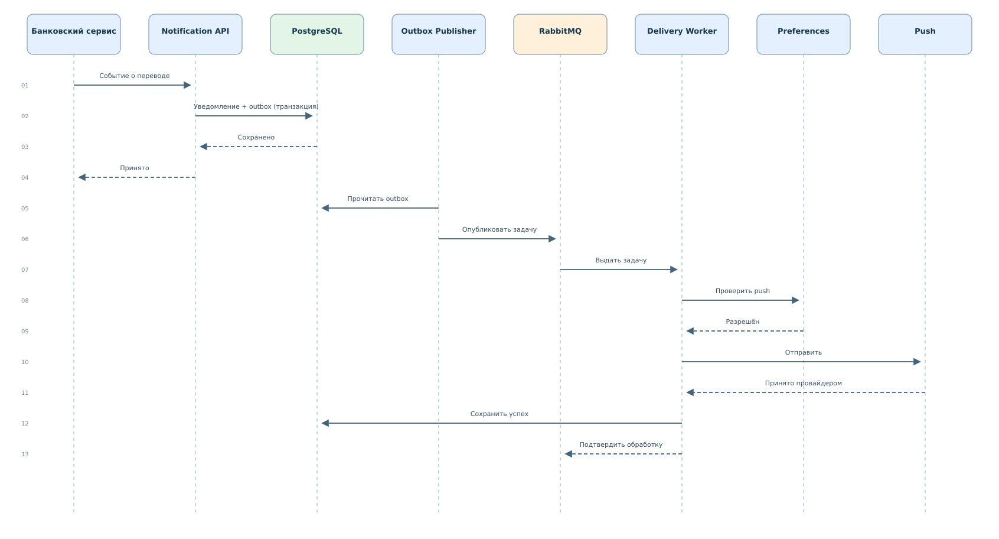
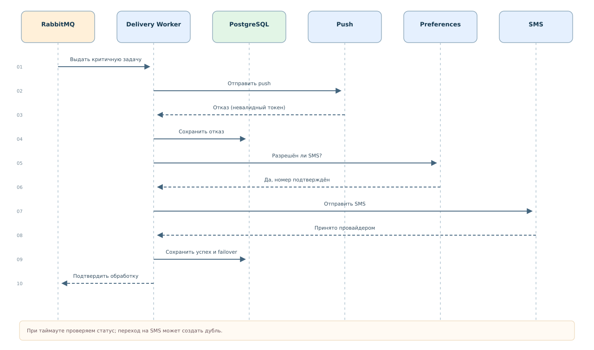
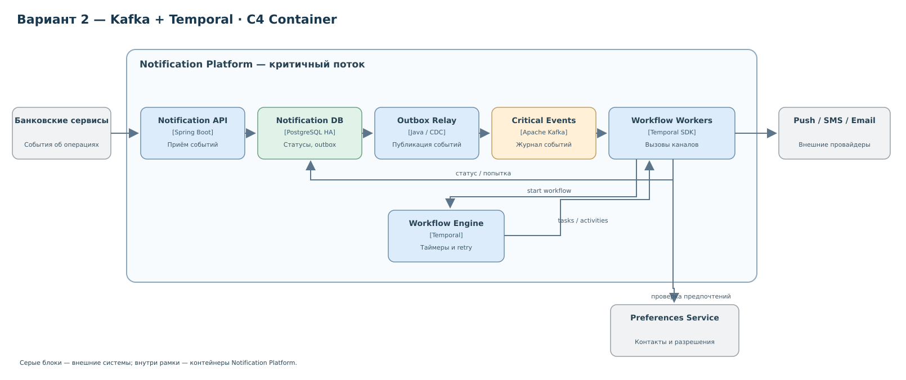
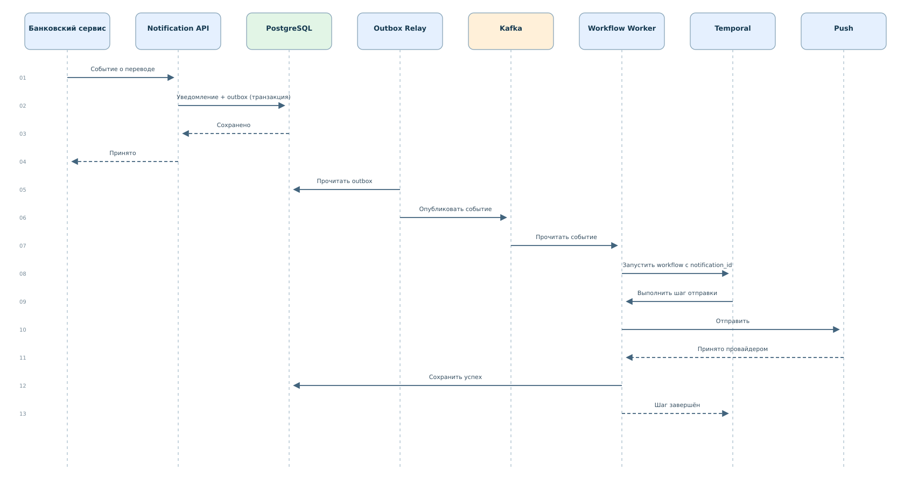
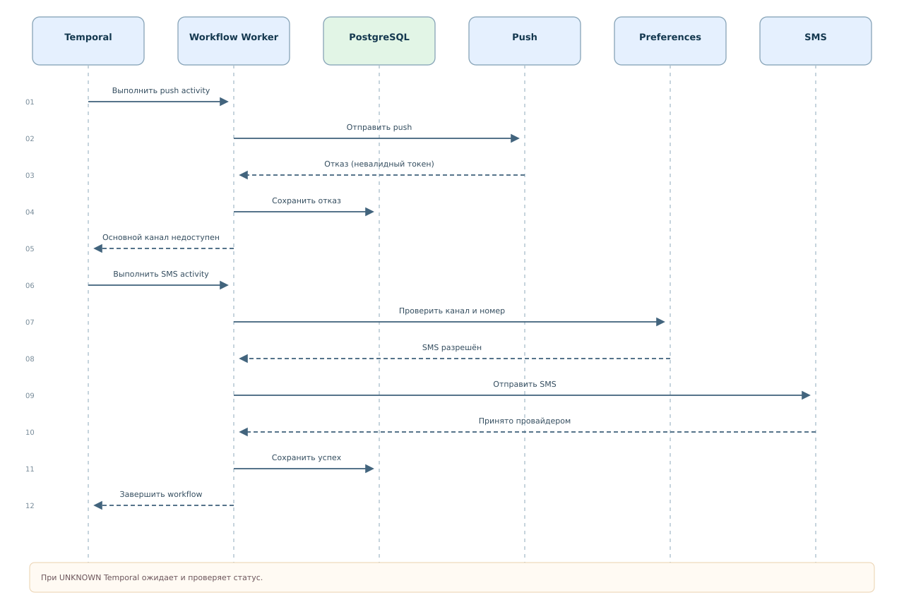

# RFC: Гарантированная доставка критичных уведомлений с кросс-канальным failover

| Метаданные | Значение |
|---|---|
| **Статус** | DESIGN |
| **Автор** | Валентина Доможакова |
| **Ответственный** | Команда Notification Platform (проектная роль) |
| **Бизнес-заказчик** | Команда клиентских коммуникаций банка (проектная роль) |
| **Ревьюеры** | Архитектор, SRE, информационная безопасность — на согласовании |
| **Дата создания** | 2026-11-17 |
| **Дата обновления** | 2026-11-17 |

## Оглавление

1. [Контекст](#контекст)
2. [Продуктовый анализ](#продуктовый-анализ)
3. [Пользовательские сценарии](#пользовательские-сценарии)
4. [Статистика](#статистика)
5. [Требования](#требования)
6. [Варианты решения](#варианты-решения)
7. [Сравнительный анализ](#сравнительный-анализ)
8. [Выводы](#выводы)
9. [Связанные задачи](#связанные-задачи)
10. [Приложения](#приложения)

## Контекст

Сейчас разные сервисы банка отправляют сообщения самостоятельно, поэтому критичные уведомления о переводах и списаниях могут задерживаться, теряться или дублироваться. В пунктах 1–7 предложена общая Notification Platform. Этот RFC рассматривает её **подсистему доставки критичных уведомлений**: сохранение событий, выбор канала, retry, failover и контроль результата. Маркетинговая доставка остаётся в общей платформе, но использует отдельные ресурсы.

В качестве основного канала по умолчанию выбираем **push**, если он разрешён и доступен; при отказе можно перейти на **SMS**, а затем на email, если канал допустим. Приоритет пользователя и актуальность контактов могут изменить этот порядок. Обязательные критичные уведомления нельзя полностью отключить; их перечень должен быть утверждён банком.

**Граница гарантии.** Платформа обязуется не терять принятое уведомление и добиваться передачи через хотя бы один допустимый канал. Целевые SLA измеряются до статуса **`PROVIDER_ACCEPTED`** — провайдер принял сообщение. Это не равнозначно фактическому получению или прочтению человеком. Если все каналы недоступны, фиксируется ошибка и инициируется разбор инцидента.

## Продуктовый анализ

| Бизнес-цель | Что даёт решение | Как оценивать |
|---|---|---|
| Рост retention на 15% | Более своевременные и понятные сообщения | Изменение D30 retention; причинный эффект проверять отдельно |
| Меньше жалоб на 30% | Меньше дублей и задержек, история отправок для поддержки | Жалобы на 100 тыс. уведомлений и абсолютное количество жалоб |
| Надёжная доставка критичных сообщений | Повторные попытки и резервные каналы | Доля подтверждений провайдера ≤60 с, число неотправленных сообщений |

## Пользовательские сценарии

| Приоритет | Тип | Действующее лицо | Сценарий |
|---|---|---|---|
| MUST HAVE | Основной | Клиент | После перевода получает уведомление через предпочтительный доступный канал. |
| MUST HAVE | Failover | Платформа | При подтверждённом отказе push переходит на разрешённый резервный канал. |
| MUST HAVE | Восстановление | Платформа | После сбоя обработчика принятое уведомление не пропадает и продолжает обрабатываться. |
| MUST HAVE | Повтор события | Банковский сервис | Повторная передача события не создаёт ещё одно логическое уведомление. |
| MUST HAVE | Настройки и контроль | Клиент / поддержка | Учитываются предпочтения клиента; поддержка может проверить статус и причины ошибки. |

## Статистика

По условиям задания: **MAU 10 млн**, **DAU 3 млн**, одновременно активных пользователей — **до 300 тыс.** Предполагаем, что указанные средние числа уведомлений относятся к DAU.

| Тип | Расчёт | В день | В среднем в секунду |
|---|---|---:|---:|
| Транзакционные | 3 млн × 2 | 6 млн | 69 |
| Сервисные | 3 млн × 3 | 9 млн | 104 |
| Маркетинговые | 3 млн × 5 | 15 млн | 174 |
| **Всего** | 3 млн × 10 | **30 млн** | **347** |

**Пики.** Кампания на 1 млн клиентов за 15 минут создаёт около **1 111 отправок/с** сверх обычного потока. Для проектирования принимаем **5 000 новых уведомлений/с в течение 30 минут** как стресс-профиль всей платформы, из них условно до **1 000 критичных/с**. Это допущения для тестирования, а не наблюдаемая статистика банка. Peak Concurrent Users не следует напрямую приравнивать к RPS.

**Повторные попытки.** Если 5% критичных сообщений потребуют ещё одной попытки, получится **6 млн × 1,05 = 6,3 млн попыток/день**, или **≈73 попытки/с** в среднем. При массовом отказе канала нагрузка на резервного провайдера может быть значительно выше; потребуется учитывать его лимиты.

## Требования

Здесь уточняются требования из [части 1](requirements_1-7.md) применительно к критичному потоку. Идентификаторы FR, NFR и ASR сохранены.

### Функциональные требования

| № | Приоритет | Обозначение | Требование |
|---|---|---|---|
| 1 | MUST HAVE | FR-2, FR-5 | Принимать банковское событие и создавать одно логическое уведомление, в том числе при повторном событии. |
| 2 | MUST HAVE | FR-3, FR-6 | Определять допустимый канал по настройкам и подтверждённым контактам. |
| 3 | MUST HAVE | FR-4 | Повторять неуспешную попытку или выбирать резервный канал. |
| 4 | MUST HAVE | FR-8 | Сохранять статус, попытки и результат переключения канала. |
| 5 | MUST HAVE | FR-4, FR-8 | При исчерпании доступных каналов фиксировать ошибку и сигнализировать ответственным. |

### Нефункциональные требования

| № | Приоритет | Обозначение | Требование |
|---|---|---|---|
| 1 | MUST HAVE | NFR-1 | При штатном канале p95 ≤2 с, p99 ≤10 с до подтверждения приёма провайдером. |
| 2 | MUST HAVE | NFR-2 | Не менее 99,9% критичных сообщений подтверждены провайдером ≤60 с при наличии доступного разрешённого канала. |
| 3 | MUST HAVE | NFR-3, NFR-4 | RPO = 0 при указанном отказе узла/зоны; доступность приёма ≥99,95% в месяц. |
| 4 | MUST HAVE | NFR-5, NFR-6 | Работа при расчётном пике 5 000 новых событий/с без деградации критичного потока. |
| 5 | MUST HAVE | NFR-7, NFR-8 | Защита от второго логического уведомления и учёт новых настроек ≤5 с. |
| 6 | MUST HAVE | NFR-9, NFR-10 | История 100% критичных попыток, оповещения и защита персональных данных. |

### Архитектурно значимые требования

| ASR | Приоритет | Смысл для RFC |
|---|---|---|
| ASR-1 | P0 | Сохранность и восстановление отправки после отказов |
| ASR-2 | P0 | Минимальная задержка при штатной доставке |
| ASR-3 | P0 | Масштабирование и изоляция критичной нагрузки |
| ASR-4 | P0 | Идемпотентность и минимизация дублей |
| ASR-5 | P0 | Корректный выбор разрешённого канала |
| ASR-6 | P1 | Мониторинг, аудит и защита данных |

**Общая политика failover.** При достоверном отказе канала отправляем через следующий допустимый. При **таймауте** исход неизвестен: провайдер мог уже принять сообщение. Поэтому сначала проверяем статус или повторяем запрос с тем же идемпотентным ключом, если это поддерживается. Если установить исход не удаётся, переключаемся согласно ограничению времени и принятой политике риска дублей. Абсолютно исключить внешние дубли в этом случае нельзя.

## Варианты решения

### Вариант 1. PostgreSQL + RabbitMQ + Delivery Workers

**Архитектура.** Notification API устойчиво сохраняет уведомление в PostgreSQL. Запись в outbox создаётся в той же транзакции, после чего Publisher передаёт задание в RabbitMQ. Delivery Worker проверяет предпочтения, отправляет сообщение, сохраняет результат. При ошибке выполняет retry или failover; запланированные повторы запускает Retry Scheduler. Для критичных задач выделены отдельные очередь и обработчики.

**Технологии:** Spring Boot (API и workers), PostgreSQL HA (статусы, попытки, outbox), RabbitMQ quorum queues (устойчивая очередь), Prometheus/Grafana (мониторинг). Внешние push/SMS/email-провайдеры подключаются через HTTPS.

#### C4 Container

[Исходник C4 (PlantUML)](diagrams/01_variant1_c4.puml)

#### Sequence Diagram — успешная доставка

[Исходник sequence (PlantUML)](diagrams/02_variant1_success.puml)

#### Sequence Diagram — failover

[Исходник sequence (PlantUML)](diagrams/03_variant1_failover.puml)

#### Выполнение ASR

| ASR | Как обеспечивается |
|---|---|
| ASR-1 | PostgreSQL HA, outbox, устойчивая очередь, retry/failover |
| ASR-2 | Отдельная критичная очередь и workers, короткий путь к push |
| ASR-3 | Горизонтальное масштабирование и изоляция маркетинговых задач |
| ASR-4 | Уникальный ключ события, статусы попыток, идемпотентность |
| ASR-5 | Проверка предпочтений перед основным и резервным каналами |
| ASR-6 | История в БД, метрики, алерты, шифрование и разграничение доступа |

#### Этапы реализации

| Этап | Срок (оценка) | Ресурсы | Основной риск |
|---|---|---|---|
| 1. Согласовать правила каналов и контракты | 1–2 недели | Аналитик, backend, ИБ | Неясные возможности провайдеров |
| 2. Реализовать API, БД, очередь и failover | 3–5 недель | 2–3 backend, SRE | Потеря состояния или дубли |
| 3. Тестирование и запуск | 2–3 недели | Backend, QA, SRE | Нарушение SLA при пиках |

**Преимущества:** небольшой набор технологий, понятное хранение состояния, удобно масштабировать критичных обработчиков. **Недостатки:** таймеры повторов и переходы состояний приходится реализовывать и тестировать самостоятельно.

### Вариант 2. PostgreSQL + Kafka + Temporal

**Архитектура.** API сохраняет уведомление в PostgreSQL, а outbox relay передаёт событие в Kafka. Worker запускает **Temporal Workflow** с идентификатором уведомления. Temporal управляет шагами отправки, таймерами и повторами; worker выполняет вызовы провайдеров и сохраняет результаты. PostgreSQL остаётся хранилищем статусов для поддержки и аудита.

**Технологии:** Spring Boot, PostgreSQL HA, Apache Kafka (входящий поток событий), Temporal (workflow и таймеры), Prometheus/Grafana. Temporal требует собственного отказоустойчивого хранилища состояния. Внешние провайдеры подключаются через HTTPS.

#### C4 Container

[Исходник C4 (PlantUML)](diagrams/04_variant2_c4.puml)

#### Sequence Diagram — успешная доставка

[Исходник sequence (PlantUML)](diagrams/05_variant2_success.puml)

#### Sequence Diagram — failover

[Исходник sequence (PlantUML)](diagrams/06_variant2_failover.puml)

#### Выполнение ASR

| ASR | Как обеспечивается |
|---|---|
| ASR-1 | Устойчивые события Kafka, история workflow и повторные Activities |
| ASR-2 | Отдельные workers критичного потока и ограниченные таймауты |
| ASR-3 | Партиции Kafka и независимое масштабирование workers |
| ASR-4 | Стабильный workflow ID, уникальные записи в БД и учёт попыток |
| ASR-5 | Проверка разрешений в каждом шаге отправки |
| ASR-6 | История Temporal и PostgreSQL, мониторинг, защита данных |

#### Этапы реализации

| Этап | Срок (оценка) | Ресурсы | Основной риск |
|---|---|---|---|
| 1. Правила каналов и контракты | 1–2 недели | Аналитик, backend, ИБ | Неясные возможности провайдеров |
| 2. Kafka, Temporal и логика доставки | 4–6 недель | 3 backend, 1–2 SRE | Сложность настройки и эксплуатации |
| 3. Тестирование и запуск | 3–4 недели | Backend, QA, SRE | Задержки и повторы внешних вызовов |

**Преимущества:** готовое управление таймерами, повторами и восстановлением многошагового процесса; удобнее расширять сложные сценарии. **Недостатки:** больше инфраструктуры и выше сложность эксплуатации. Temporal **не устраняет** риск повторного внешнего SMS при неопределённом ответе.

## Сравнительный анализ

### Ресурсные требования

| Критерий | Вариант 1 | Вариант 2 |
|---|---|---|
| Срок реализации (оценка) | 6–10 недель | 8–12 недель |
| Команда | 2–3 backend + SRE/QA | 3 backend + 1–2 SRE + QA |
| Инфраструктура | PostgreSQL HA, RabbitMQ | PostgreSQL HA, Kafka, Temporal и его БД |
| Основной риск | Ошибки собственной логики retry/failover | Сложность эксплуатации нескольких систем |

### Соответствие требованиям

| Требование / ASR | Вариант 1 | Вариант 2 |
|---|---|---|
| FR-2, FR-4 — отправка и failover | Да, через workers | Да, через workflow |
| FR-5, NFR-7 — защита от логических дублей | Да, ключ в БД | Да, ключ в БД + workflow ID |
| FR-3, FR-6 — пользовательские настройки | Да | Да |
| FR-8, NFR-9 — история и мониторинг | Да | Да |
| NFR-1–4 — задержка и надёжность | Достижимо при HA и тестировании | Достижимо при HA и тестировании |
| NFR-5–6 — нагрузка и изоляция | Да, выделенные очереди/workers | Да, выделенный поток/workers |
| ASR-1–ASR-6 | Выполнение описано выше | Выполнение описано выше |

Ни один стек **сам по себе** не гарантирует выполнение численных SLA: они подтверждаются тестами.

### Основные компромиссы

1. **Скорость и дубли.** Быстрый переход с push на SMS уменьшает задержку, но при таймауте push может привести к двум сообщениям. Проверка статуса снижает риск дубля, но занимает время.
2. **Стоимость и надёжность.** Последовательный failover экономит SMS по сравнению с постоянной отправкой по нескольким каналам; при аварии push расходы и нагрузка на SMS возрастут.
3. **Простота и расширяемость.** Вариант 1 проще для текущего сценария. Вариант 2 удобнее при длинных процессах и сложных правилах, но требует больше ресурсов.

## Выводы

**Предпочтительный вариант — PostgreSQL + RabbitMQ + Delivery Workers.** Из расчёта получается около **69 критичных уведомлений/с в среднем**. Основная задача здесь не обработать экстремально большой поток, а надёжно сохранить сообщение, отправить его и корректно переключить канал при ошибке. Для этого достаточно устойчивой очереди, БД с состояниями и обработчиков. Kafka + Temporal тоже подходит, но при относительно коротком процессе добавляет инфраструктурную сложность без принципиально более сильной гарантии фактической доставки.

При выборе первого варианта принимаем необходимость самостоятельно поддерживать retry и failover. Если в банке уже используется Temporal или процессы станут значительно сложнее, решение стоит пересмотреть. Главное ограничение обоих вариантов: недоступность всех каналов и неопределённый ответ провайдера не позволяют гарантировать получение человеком и полное отсутствие внешних дублей.

## Связанные задачи

| Задача | Критерий готовности | Зависимость |
|---|---|---|
| Согласовать обязательные уведомления и разрешённые каналы | Утверждены настройки и порядок failover | Бизнес, ИБ |
| Проверить возможности провайдеров | Известны подтверждения, лимиты и варианты повторной отправки | U-1, U-3 |
| Реализовать идемпотентность, хранение и failover | Повтор события не создаёт новое уведомление; отказ push ведёт к допустимому резерву | ASR-1, ASR-4 |
| Проверить сбои и производительность | Пройдены сценарии отказа worker, таймаута провайдера и пика 5 000/с | U-2, NFR-1–6 |
| Настроить мониторинг и запуск | Видны статусы/ошибки, настроены алерты и постепенное включение | ASR-6 |

## Приложения

### Краткий глоссарий

| Термин | Значение |
|---|---|
| **Transactional Outbox** | Запись события в одной транзакции с основными данными для последующей надёжной публикации. |
| **Idempotency** | Повторная обработка того же события не создаёт новый логический результат. |
| **Failover** | Переключение на другой разрешённый канал после отказа основного. |
| **At-least-once** | Задание может быть доставлено обработчику повторно, поэтому нужны проверки дублей. |
| **RPO** | Допустимая потеря данных при аварии. |
| **`PROVIDER_ACCEPTED`** | Провайдер принял сообщение, но пользователь мог ещё не получить его. |
